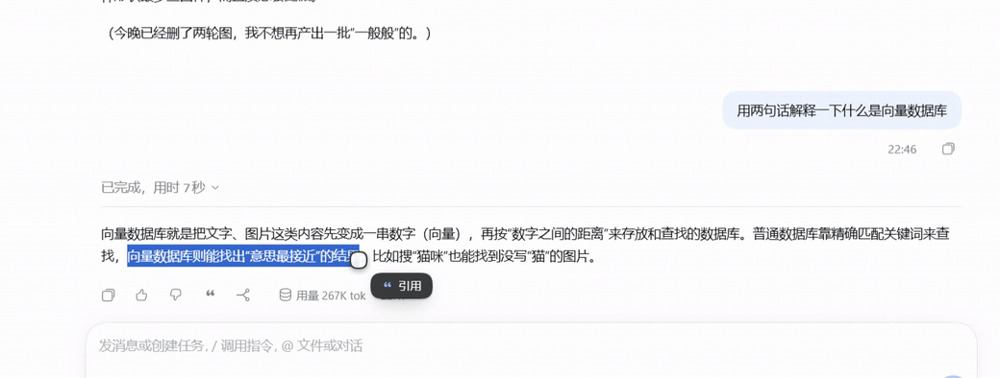

# dsh-quote-to-composer

中文 | [English](README.en.md)

> 在 DSH 里**选中一段文字 → 点一下「引用」→ 它就变成输入框里的一条迷你引用条**，
> 接着写你的追问，一起发出去。适合「这句话什么意思」「这段代码为什么报错」这种指代式提问。




## 它能做什么

- **选中即引用**：在助手回复、代码块、表格、侧栏预览里选中任意文字，松开鼠标后指针右下方出现一个深色胶囊「引用」，点它即可。
- **整条引用**：每条助手回复的动作行（复制 / 好的回答 / 有问题的回答 / …）里多了一个「引用这条回复」按钮，一键引用整条回答。
- **输入框里是迷你条，不是一大段文字**：插入后是 21px 高的灰色圆角小条 +「引用」两个字，和正文同一行高，不占地方。
- **悬停看全文**：鼠标停在引用条上会浮出深色卡片，显示被引用的完整内容（多行、代码都保留）。
- **发出去是引用卡片**：消息发出后，用户气泡里渲染成引用卡片；模型收到的是标准 Markdown 引用块：

  ```
  > 被引用的每一行
  ```

- **键盘也能用**：`Ctrl+Shift+Q`（Windows / macOS 统一用 Ctrl）。
- **深色 / 浅色主题自适应**；刷新页面后草稿里的引用条不会丢，悬停照样能看全文。
- 纯前端插件，无原生依赖，**Windows / macOS / Linux 通用**。

## 下载

**两个平台的包内容完全一样**（同一份前端代码），只是附带的安装说明不同，按你的系统下对应的那个就行。

| 平台 | 下载 | 备注 |
| --- | --- | --- |
| Windows | [dsh-quote-to-composer-0.9.2-windows.zip](https://github.com/bigbigman-001/dsh-quote-to-composer/releases/latest/download/dsh-quote-to-composer-0.9.2-windows.zip) | 解压后看包里的 `INSTALL-windows.md` |
| macOS | [dsh-quote-to-composer-0.9.2-macos.zip](https://github.com/bigbigman-001/dsh-quote-to-composer/releases/latest/download/dsh-quote-to-composer-0.9.2-macos.zip) | 解压后看包里的 `INSTALL-macOS.md` |
| 任意平台（npm 包） | [dsh-quote-to-composer-0.9.2.tgz](https://github.com/bigbigman-001/dsh-quote-to-composer/releases/latest/download/dsh-quote-to-composer-0.9.2.tgz) | 给熟悉 npm 包的人 |

也可以不下载，直接在 DSH 里装（见下）。

## 安装

### 方式 A（推荐，不用命令行）：在 DSH 里装

1. 打开 DSH，左侧点 **插件**
2. 右上角点 **添加插件**
3. 输入框里填：

   ```
   github:bigbigman-001/dsh-quote-to-composer
   ```

   （如果网络慢，勾上「中国大陆镜像源」）
4. 点 **安装**，然后刷新页面

### 方式 B：下载 zip 装

1. 按上表下载对应平台的 zip，解压得到 `dsh-quote-to-composer` 文件夹
2. 同上打开 **插件 → 添加插件**
3. 输入框里填**解压出来的目录路径**，例如：
   - Windows：`D:\plugins\dsh-quote-to-composer`
   - macOS：`/Users/你的用户名/plugins/dsh-quote-to-composer`
4. 点 **安装**，刷新页面

### 方式 C：命令行

```sh
dsh plugin --profile desktop add github:bigbigman-001/dsh-quote-to-composer
```

> Windows 与 macOS 步骤完全一致——插件是纯前端代码，两个平台跑的是同一份。
> macOS 上快捷键同样是 **Ctrl+Shift+Q**，不是 `Cmd+Shift+Q`（后者是系统「注销」）。

## 用法

**三步**：

1. 用鼠标选中你想引用的文字 → 松开后指针旁出现「引用」胶囊 → 点它
   （或者按 `Ctrl+Shift+Q`；也可以点助手回复下面的「引用这条回复」引用整条）
2. 输入框里出现一条灰色的「引用」小条，鼠标悬停可以确认引用内容对不对
3. 直接继续写你的问题，正常发送即可

发出的消息里引用部分会渲染成卡片，模型看到的是 `> …` 引用块，所以它能准确知道你在问哪一句。

> 胶囊只在「松开鼠标 + 确实选中了文字 + 选区不在输入框内」时出现；
> 点空白处、滚动、按 `Esc` 都会立刻收起。

## 卸载 / 升级

- **卸载**：DSH → 插件 → 已安装插件 → 找到 `dsh-quote-to-composer` → 卸载
- **升级**：再走一次安装即可（或用新版本 zip / 新的 `github:` 拉取）

## 常见问题

| 现象 | 原因与处理 |
| --- | --- |
| 选中文字后没有出现胶囊 | 选区在输入框里（插件故意不处理）；或只点了没拖动（没有真正选中）；或选中的是纯空白 |
| `Ctrl+Shift+Q` 没反应 | 焦点不在页面上（先点一下正文）；或和其它软件快捷键冲突 |
| 输入框里残留一条引用条 | 点进输入框 `Ctrl+A` 再 `Delete` 清空草稿即可 |
| 引用条上的悬停卡片里是空内容 | 极少数情况下草稿被外部改动；删掉重引一次 |
| 发送后模型好像没看到引用 | 看用户气泡里有没有渲染出引用卡片；没有就是没插进去，重来一次 |
| 引用条样式很怪 | 需要较新的 Chromium（Electron / Chrome 105+）；旧内核会走纯色兜底 |

## 兼容性

- 插件是 `window.__ModuleLoader__.load(...)` 形式的浏览器模块，**不含任何 Windows/macOS 专有 API**
- 只用浏览器标准能力：`getSelection`、`Range`、`matchMedia` 间接（主题变量）、CSS `color-mix()`（带纯色兜底）
- 字体栈包含 `-apple-system` / `PingFang SC`，图标用 `-webkit-mask` + `mask` 双写

## 开发者说明

### 目录结构

```
client.js           全部前端逻辑（宿主半边 index.js 是空的，纯视图插件）
index.js            export function apply() {} —— 故意为空
cordis.patch.yml    插件挂载声明
locale/{zh,en}.json 文案
icon.svg            商店图标
screenshots.json    商店截图声明
docs/               截图、安装说明、上架流程
scripts/publish.ps1 一键推送到 GitHub 的脚本（给发布者用）
```

### 实现要点

- 四个挂载点（都做了失败隔离，单点注册失败不影响其它部分）：
  - `conversation.input.dock` — 无渲染的 `Capture`，把当前会话的 `inputActions`
    发布到模块级 `live`，并把 `useInput` 的 `occurrences` 镜像到 `liveOccurrences`
    （刷新后从草稿恢复的引用条靠它找回悬停内容）；
  - `conversation.chat.assistant-actions` — 「引用这条回复」按钮；
  - `conversation.user.text.node` + `uiConversation.userText` 规则 `quote` —
    把发出的 `> …` 段落渲染成引用卡片；
  - `inputTriggers.registerSource(QUOTE_SOURCE)` — `source: 'quote'` 的序列化 owner。
- 插入走 `inputTriggers.sessionOf(session.ctx).execute({ insert: reference }, span)`
  → 会话事件 `slash/input-insert-reference` → `shell.insertReference()`，
  生成一个 `ReferenceChipNode`：`label` 是「引用」，`clipboardText` 是完整的
  `> …` 块（提交时模型看到的就是它）。插入失败才回退到纯 `> …` 文本插入。
- 引用条样式不套用 DSH 默认芯片，而是用 CSS 覆盖 `[data-composer-chip="quote"]`：
  灰底、全圆角、21px 高、12px 字，隐藏自带图标，用 `::before` + mask 数据 URI 画自己的引号图标。
- 悬停卡片 `.dqc-tip`：`mouseover/mouseout` 委托监听，内容只取自
  `useInput().occurrences` 里 `source === 'quote'` 的那几条（按芯片顺序对齐、剥掉 `> ` 前缀），
  不在 DOM 上缓存引用原文，避免"插入 A 却标到 B"的错标。
- 提交必须能找到 `source: 'quote'` 的 codec，否则会报
  `slash: no serializer for reference source "quote"` 并让发送失败——所以 `QUOTE_SOURCE` 必须注册。
- 引用在 prompt 里占的文本是 `> 每一行` + 一个**空行**。空行直接写进芯片的 `clipboardText`，
  而不是插入后用 `insertText` 补（补出来的空行会和插入坐标打架，插第二条引用时多出空白行）；
  有了这个空行，紧跟在芯片后面的追问才不会被 Markdown 懒续行吞进引用块。

## 验证状态

- 已在真实页面（`http://192.168.0.109:3822/`，v0.8.2 代码）逐项验证：
  鼠标选中 → 胶囊出现在指针右下方、靠边翻转；点胶囊 → 输入框出现
  `height:21px` 的「引用」条；悬停浮出深色卡片且内容正确；连插两条不串号；
  刷新后引用条从草稿恢复且悬停仍可用；深色主题配色正确；
  端到端「引用一句 + 追问」发出后气泡渲染引用卡片、模型按被引用文字作答；
  控制台无本插件告警。
- 用户气泡渲染规则单测 `_probe/quote-rule.test.mjs` 8/8。
- 0.9.0 / 0.9.1 / 0.9.2 只改发布元数据与文档，未改交互逻辑。

## 许可

[MIT](LICENSE)
