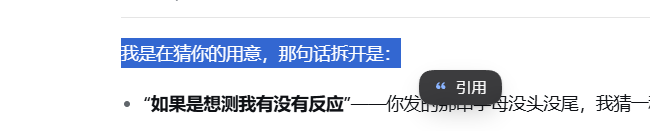
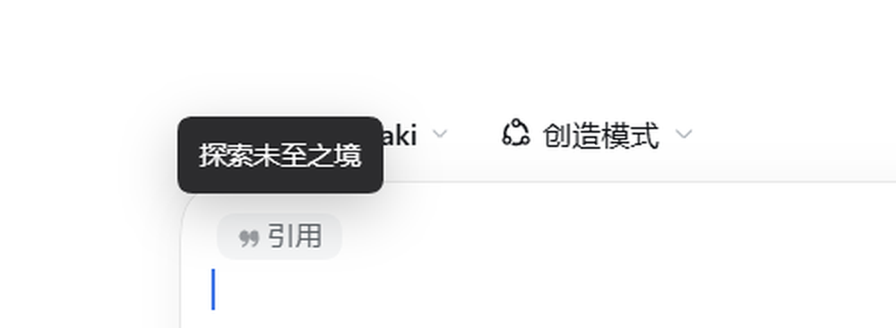

# dsh-quote-to-composer

中文 | [English](README.en.md)

在 DSH 界面里选中任意文字（或整条助手回复），把这段文字**引用到当前会话的输入框**，
随后可以直接追问，一起发出去。





## 安装

```sh
dsh plugin --profile desktop add github:<你的GitHub用户名>/dsh-quote-to-composer
```

装完刷新页面即可用（无需重启）。

## 发布 / 上架市场

- 零基础全流程（注册 GitHub → 建仓库 → 推送 → 加 topic → 等 1 天 → 提 PR）：
  [docs/PUBLISH.md](docs/PUBLISH.md)
- 一把推送（自动写 `repository`/`homepage`/`bugs`、`git init`、提交、推送）：

  ```powershell
  powershell -ExecutionPolicy Bypass -File .\scripts\publish.ps1 -GitHubUser 你的用户名
  ```

- awesome-dsh-plugin 条目模板：[docs/awesome-dsh-plugin-entry.yml](docs/awesome-dsh-plugin-entry.yml)
- 商店截图声明：[screenshots.json](screenshots.json)（`docs/screenshot-*.png`）

## 用法

1. **引用选区**：在助手回复、代码块、表格、侧栏预览等任意位置用鼠标选中文字 →
   **松开鼠标后，指针右下方会出现一个深色胶囊「引用」**（28px 高、全圆角、
   浅蓝引号图标，带柔和投影和 160ms 缩放淡入），点它即可；
   靠近屏幕右/下边缘时自动翻到指针另一侧。键盘选择也可以按 `Ctrl+Shift+Q`
   （各平台统一用 Ctrl；`Cmd+Shift+Q` 在 macOS 上是注销，故意不支持）。
2. **引用整条回复**：每条助手回复的动作行（复制 / 好的回答 / 有问题的回答 / …）里
   点「引用这条回复」。
3. 两种方式都会在输入框里插入一条**迷你引用条**：灰色圆角胶囊、21px 高、12px 字、
   引号图标 + 「引用」两个字，和正文同一行高度，不占地方。
   **鼠标悬停在这条引用上会浮出深色卡片，显示被引用的完整内容**。
   接着输入你的问题即可，引用和追问一起发出去。

发出的消息里，引用部分会渲染成一张引用卡片；模型收到的是

```
> 被引用的每一行
```

这样的 Markdown 引用块。

> 浮动胶囊只在「鼠标松开 + 确实选中了文字（且选区不在输入框内）」时出现；
> 点空白处、滚动、按 `Esc`、或在输入框内选中文字时都会立刻收起。

## 实现要点

- 四个挂载点（都做了失败隔离，单点注册失败不影响其它部分）：
  - `conversation.input.dock` — 无渲染的 `Capture`，把当前会话的 `inputActions`
    发布到模块级 `live`，并把 `useInput` 的 `occurrences` 镜像到 `liveOccurrences`
    （刷新后从草稿恢复的引用条靠它找回悬停内容）；
  - `conversation.chat.assistant-actions` — 「引用这条回复」按钮；
  - `conversation.user.text.node` + `uiConversation.userText` 规则 `quote` —
    把发出的 `> …` 段落渲染成引用卡片（`conversation.user.text.node` 的 keyDomain
    声明是固定集合，但运行期接受新 key）；
  - `inputTriggers.registerSource(QUOTE_SOURCE)` — `source: 'quote'` 的序列化 owner。
- 插入走 `inputTriggers.sessionOf(session.ctx).execute({ insert: reference }, span)`
  → 会话事件 `slash/input-insert-reference` → `shell.insertReference()`，
  生成一个 `ReferenceChipNode`：`label` 是「引用」，`clipboardText` 是完整的
  `> …` 块（提交时模型看到的就是它）。插入失败（比如 `draftRev` 失配两次）才回退到
  纯 `> …` 文本插入。
- 引用条的样式不套用 DSH 默认芯片，而是用 CSS 覆盖
  `[data-composer-chip="quote"]`：灰底（`--dsw-alias-markdown-placeholder`）、
  全圆角、21px 高、12px 字，隐藏 DSH 自带图标，用 `::before` + mask 数据 URI
  画自己的引号图标（`currentColor`，跟随深浅主题）。
- 悬停卡片 `.dqc-tip`：`mouseover/mouseout` 委托监听（`relatedTarget` 在芯片内部
  移动时不收起），内容只取自 `useInput().occurrences` 里 `source === 'quote'` 的那几条
  （按 `quote` 芯片的顺序对齐，剥掉 `> ` 前缀）——不在 DOM 上缓存任何引用原文，
  避免"插入 A 却标到 B"的错标；`Capture` 同时镜像 `detectText`，供
  `leadingBreak` 用与 `captureInsertion` 同一套偏移量判断空行。
- 悬停时会移除 DSH 自动加的 `title="引用"`，否则浏览器原生 tooltip 会叠在卡片上。
- 提交必须能找到 `source: 'quote'` 的 codec，否则报
  `slash: no serializer for reference source "quote"` 并让发送失败。
- 引用在 prompt 里占的文本是 `serializeQuote()`：`> 每一行` + 一个**空行**。
  空行直接写在芯片的 `clipboardText` 里，而不是插入后用 `insertText` 补——补出来的
  空行会和 `captureInsertion` 的偏移坐标打架，插入第二条引用时多出几行空白。
  有了这个空行，紧跟在芯片后面的追问才不会被 Markdown 懒续行吞进引用块。
- 更早一版（浮动胶囊 + 纯文本插入）的备份已移到
  `..\..\_probe\archive\quote-to-composer-v2.client.js`，插件目录只留打包用文件。

## 验证状态

- 已验证（`http://192.168.0.109:3822/` 实际页面，v0.8.2；0.9.0 只改发布元数据）：
  - 鼠标选中文字 → 松开后胶囊出现在指针右下方（`left=pointer+14, top=pointer+14`），
    靠边时翻转（`data-side=left`，`transform-origin:100% 50%`）；
  - 点胶囊 → 输入框出现 `data-composer-chip="quote"` 引用条：
    `height:21px`、`border-radius:999px`、`background:rgb(245,246,247)`、
    `font-size:12px`、文案「引用」；
  - 悬停 → `.dqc-tip` 浮出（`background:#2c2c2e`、8px 圆角、12px 字），
    内容等于被引用文字（首尾空白已裁掉）；移出后 `data-visible` 清除；
  - 刷新后引用条从草稿恢复，悬停仍能显示内容（内容全部来自 `occurrences`）；
  - 连续插入两条引用时，悬停各自的卡片内容正确（按 `quote` 顺序对齐，不串号）；
  - 深色主题：引用条 `background:rgb(44,44,46)`、`color:rgb(207,211,214)`；卡片 `#43454A`；
  - 端到端：引用「探索未至之境」+ 追问「这句话从哪来的？」→ 用户气泡渲染出
    `.dqc-quote` 引用卡片、追问在卡片之外 → 模型按被引用文字作答（v0.8.2 实测）；
  - `@` 选择器里不会出现空的「引用」分组（source 的 `candidates` 返回空数组）；
  - 用户气泡渲染规则单测 `_probe/quote-rule.test.mjs` 8/8；
  - 控制台无本插件告警。
- 设计复核由视觉子智能体完成，采纳要点：胶囊全圆角（999px）、阴影改
  `0 1px 2px rgba(0,0,0,.2), 0 8px 20px -6px rgba(0,0,0,.28)`、图标 `#8ab4ff` 14px、
  28px 高 / 12px 字号、文案缩短为「引用」（完整语义在 `title`/`aria-label`）。
